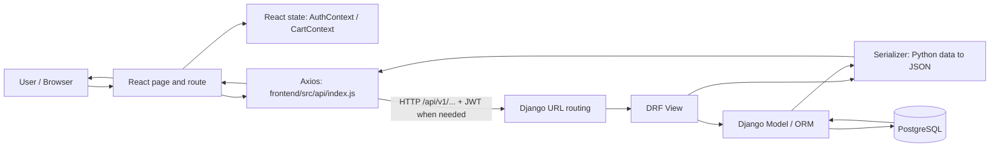
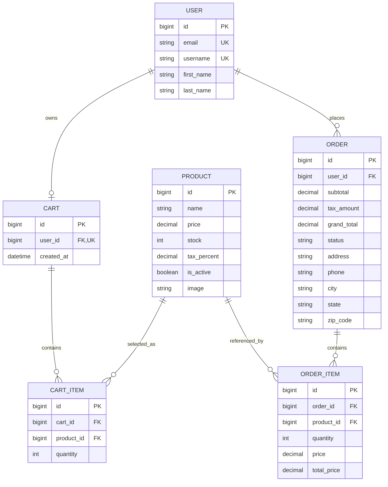
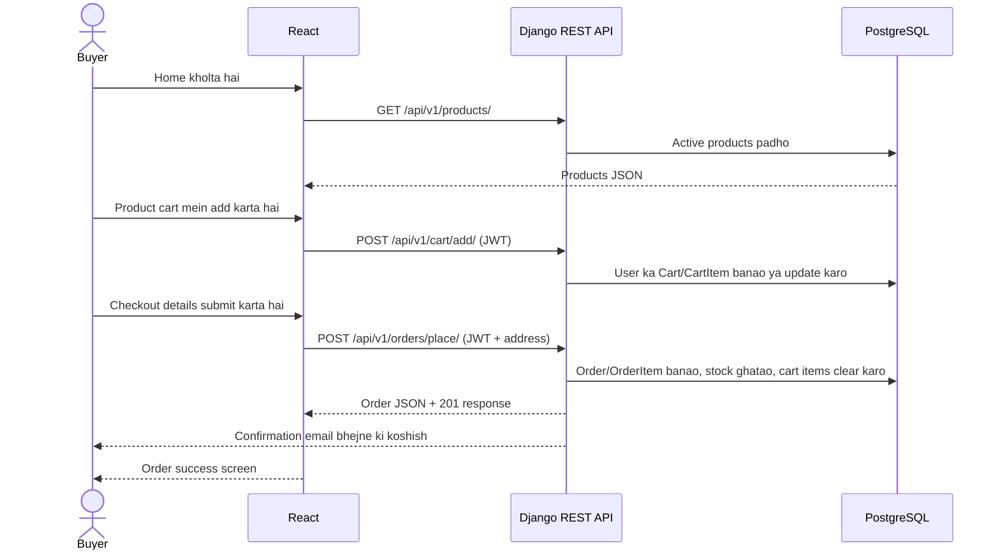

# ClickMart Project Guide (Hinglish)

Yeh project **ClickMart** naam ka e-commerce demo hai. Frontend React/Vite mein hai, backend Django REST Framework mein, aur data PostgreSQL mein store hota hai. Is guide ka goal hai ki aap code ko sahi order mein padhkar UI se database tak ka flow samajh sako.

## Project ka high-level map

```text
django_clickmart/
├── frontend/                 React UI, routes, state aur API calls
│   └── src/
│       ├── main.jsx           App ko AuthProvider aur CartProvider mein wrap karta hai
│       ├── App.jsx            Browser routes aur common Navbar/Footer
│       ├── api/index.js       Axios ka base API URL
│       ├── context/           Auth aur cart React contexts
│       ├── hooks/             useAuth aur JWT-aware useAxios
│       ├── Provider/          Auth/cart state providers
│       ├── components/        Navbar, Sidebar, order detail, quantity selector
│       └── pages/             Home, products, cart, checkout, login, dashboard
└── backend-drf/               Django project aur REST API
    ├── manage.py               Django commands ka entry point
    ├── clickmart_main/         Settings, root URLs, WSGI/ASGI
    ├── api/                    /api/v1/ ke endpoint routes
    ├── users/                  Custom User, registration, profile
    ├── products/               Product model, read APIs, admin
    ├── carts/                  Cart/CartItem models aur cart APIs
    └── orders/                 Order/OrderItem, checkout aur email notification
```

## Browser se database tak request ka raasta



Seedhi baat: React page request bhejti hai; Django URL usse sahi view tak pahunchata hai; view model ke zariye database se baat karta hai; serializer JSON response banata hai; phir React screen update karti hai.

## Database structure: kaunsi table kis se judi hai?

`users.User` Django ka custom user model hai. Diagram mein sirf app ke main business tables dikhaye gaye hain; Django auth ke built-in group/permission tables nahi dikhaye gaye.



**Isko kaise padhein:** `FK` yani foreign key doosri table ke record ko point karti hai; `UK` yani unique value. Ek user ka zero ya ek cart hota hai. Cart mein multiple cart items ho sakte hain; har cart item ek product aur quantity rakhta hai. Order banne par uske items alag `ORDER_ITEM` records hote hain. `ORDER_ITEM.price` order ke waqt ka price save karta hai, jabki product ka current price baad mein badal sakta hai.

Models ka source `backend-drf/users/models.py`, `products/models.py`, `carts/models.py` aur `orders/models.py` hai. Django ke default table names `users_user`, `products_product`, `carts_cart`, `carts_cartitem`, `orders_order` aur `orders_orderitem` hain. Database schema changes in apps ke `migrations/` folders mein hain. `clickmart_main/settings.py` PostgreSQL connection aur `AUTH_USER_MODEL` configure karta hai.

## Shopping ka end-to-end flow



Useful endpoint map (sabhi `/api/v1/` ke neeche hain):

| Kaam | Endpoint | Login required? | Django code |
|---|---|---:|---|
| Account banana | `POST /register/` | No | `users/views.py` |
| Login / JWT lena | `POST /token/` | No | SimpleJWT |
| Product list/detail | `GET /products/`, `GET /products/<id>/` | No | `products/views.py` |
| Profile dekhna/edit karna | `GET/PATCH /profile/` | Yes | `users/views.py` |
| Cart dekhna/add/update/remove | `/cart/`, `/cart/add/`, `/cart/items/<id>/` | Yes | `carts/views.py` |
| Order place/list/detail | `/orders/place/`, `/orders/`, `/orders/<id>/` | Yes | `orders/views.py` |

## Frontend pages aur unka role

| User ka screen/action | React file(s) | Backend connection |
|---|---|---|
| Home aur product browsing | `frontend/src/pages/Home.jsx`, `Products.jsx`, `ProductDetails.jsx` | Products read; cart add/update |
| Signup / login | `Register.jsx`, `Login.jsx`, `PrivateRoute.jsx` | Register, JWT; protected dashboard |
| Cart / checkout | `Cart.jsx`, `Checkout.jsx` | Cart read/change; order place |
| Order confirmation/history | `OrderSuccess.jsx`, `Orders.jsx`, `components/OrderDetail.jsx` | Order list/detail |
| Dashboard / profile | `Dashboard.jsx`, `DashboardHome.jsx`, `ProfileSetting.jsx` | Profile aur orders |
| Shared login/cart state | `Provider/`, `context/`, `hooks/` | Token React state mein; cart UI state mein |

## Code padhne ka recommended order

1. `frontend/src/main.jsx` → providers kaise app ke around wrap hote hain.
2. `frontend/src/App.jsx` → URL route se kaunsa page render hota hai.
3. `frontend/src/api/index.js` aur `frontend/src/hooks/useAxios.js` → API base URL, JWT header aur access-token refresh.
4. `frontend/src/pages/Products.jsx` → simple GET request samajhne ke liye.
5. `backend-drf/clickmart_main/urls.py` → `/api/v1/` ka entry point; phir `backend-drf/api/urls.py` → endpoint-to-view mapping.
6. Backend app mein `views.py` → `serializers.py` → `models.py` → isi order mein request ka data flow follow karein.
7. `frontend/src/pages/Cart.jsx` se `backend-drf/carts/views.py` tak cart flow dekhein.
8. `frontend/src/pages/Checkout.jsx` se `backend-drf/orders/views.py` aur `orders/utils.py` tak order/email flow dekhein.
9. `backend-drf/<app>/migrations/` padhein agar dekhna ho ki model fields database mein kis migration se aaye.

## Local run ka short path (Windows PowerShell)

Pehle PostgreSQL chalu ho aur backend ke `DB_NAME`, `DB_USER`, `DB_PASSWORD`, `DB_HOST`, `DB_PORT` settings match karein. `backend-drf/.env` mein required Django, database aur email variables set karein; asli passwords/keys ko source control mein commit na karein.

Terminal 1 — backend:

```powershell
cd backend-drf
py -m venv .venv
.\.venv\Scripts\Activate.ps1
pip install -r requirements.txt
py manage.py migrate
py manage.py runserver
```

Terminal 2 — frontend:

```powershell
cd frontend
npm install
```

`frontend/.env` mein `VITE_SERVER_BASE_URL=http://127.0.0.1:8000/api/v1` set karke:

```powershell
npm run dev
```

Vite aam taur par `http://localhost:5173/` par chalega. Product add karne ke liye Django admin user banaya ja sakta hai: backend terminal mein `py manage.py createsuperuser`, phir `http://127.0.0.1:8000/admin/`.

## Code padhte waqt dhyan dene layak baatein

- Is checkout mein root `docker-compose.yml`, backend/frontend `Dockerfile` ya GitHub Actions workflow maujood nahi hain. Repository ke `README.md` mein aage diye deployment sections un files ko banane ke tutorial steps hain; unhe current checked-in deployment setup na samjhein.
- Frontend ka `ProfileSetting.jsx` abhi placeholder UI hai; Dashboard ka profile data `DashboardHome.jsx` mein API se load hota hai.
- `backend-drf/*/tests.py` files abhi default empty test placeholders hain, isliye business flows ke automated tests filhaal nahi dikhte.
- `Home.jsx` mein `useAuth()` use hota hai, par file mein uska import nazar nahi aata. Frontend ko run/build karte waqt is page ki error aaye to pehle import check karein.
